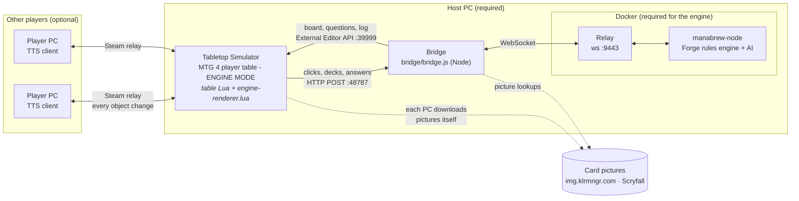
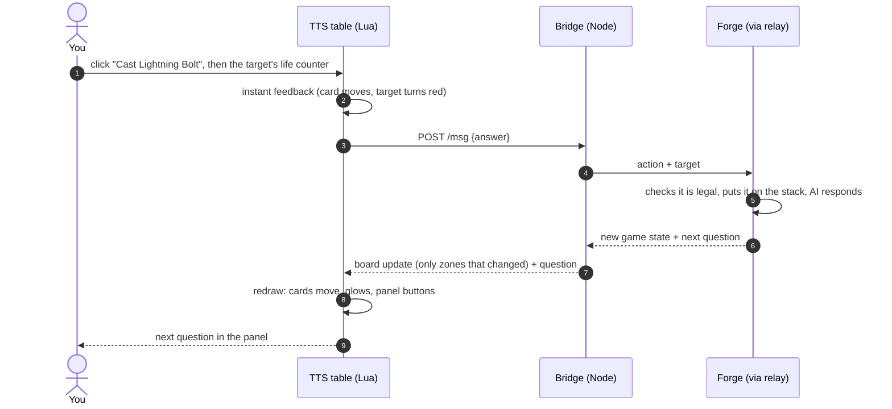
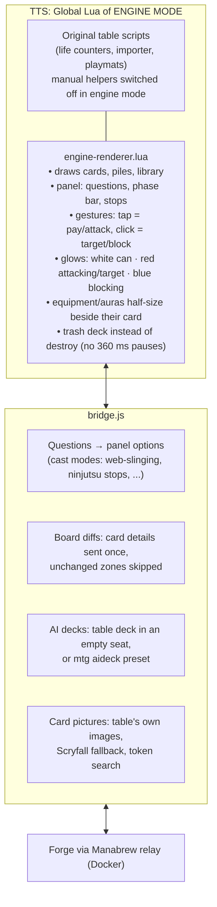

# How it works

MTG Commander on a Tabletop Simulator table, with the **Forge rules engine** (through **Manabrew**) enforcing the rules: Arena-style rules on a free-form tabletop. The diagrams below render on GitHub.

## 1. The big picture

**In one sentence:** the table shows the game and takes your clicks; the bridge translates; Forge decides what is legal and plays the AI; the table redraws whatever Forge says happened.

## 2. One click, start to finish

## 3. What is required, what is optional, and why

| Piece | Needed? | Why it exists | Without it |
|---|---|---|---|
| **Tabletop Simulator** (host) | **Required** | It's the game table everyone sees and plays on. | Nothing to play on. |
| **MTG 4 player table** (Steam workshop 2296042369), built into **ENGINE MODE** by `tools/make-engine-copy.js` | **Required** | The scripted table: playmats, life counters, card importer. ENGINE MODE adds `tools/engine-renderer.lua`, which draws the engine's game and turns your clicks into answers. | A normal manual table, with no rules enforcement. |
| **Bridge** (`bridge/bridge.js`, Node 18+) | **Required** | TTS can't talk to the engine directly. The bridge turns engine questions into panel buttons, sends only what changed, picks card pictures and handles AI decks. | The table can't reach the engine. |
| **Docker + Manabrew relay + `manabrew-node`** (Forge) | **Required** | The actual Magic rules: every card, the stack, combat and triggers, plus the Forge AI opponents. | No rules and no AI. |
| **Card picture sites** (klrmngr, Scryfall) | Required (internet) | Card images and token art. Each player's PC downloads them itself. | Blank cards. |
| **Other players' PCs** | Optional | Friends join over Steam like any TTS game. The table code runs only on the host. | Solo play against AI players. |
| **Forge AI players** (`mtg start ai N`) | Optional | Fill empty seats. A deck put in an empty seat is played by an AI. | Humans only. |
| **Cloud gaming PC as host** | Optional | Datacenter upload when the home host's upload causes lag. See `docs/server-setup-spec.md`. | Someone's home PC hosts (fine with ~5–10 Mbps upload). |
| **Linux VPS for bridge + Forge** | Optional | Frees the host's CPU, so anyone can host without Docker. See `docs/server-setup-spec.md`. | Docker runs on the host PC. |
| **Test and measurement tools** (`tools/`) | Optional (developers) | Automated games, board checks, PresentMon frame-time analysis, keyword coverage. | You lose the safety net when changing code. |

## 4. Inside the host PC

## 5. Repository map

| Folder | What's in it |
|---|---|
| `bridge/` | The bridge (Node). `bridge.js` plus card name and picture caches. |
| `tools/engine-renderer.lua` | Everything the table does in engine mode. |
| `tools/make-engine-copy.js` | Builds `MTG 4 player table - ENGINE MODE.json` from your subscribed workshop table: patches, slimming, engine code. |
| `tools/` (other) | Bridge start/stop, push to TTS, automated games (`run-coverage.sh`, `tts-autopilot*.lua`, `tts-gesture-test.js`), checks (`tts-check.lua`), performance (`pm-analyze.js`, `tts-stress-recorder.lua`), keyword coverage (`make-keyword-decks.js`, `keyword-report.js`). |
| `manabrew/` | Upstream Manabrew (engine host, relay, protocol). Its own license. |
| `docs/` | This map, the server spec, function references, keyword tables and test results. |
| `PLAN.md`, `SPEC.md`, `TESTING.md` | What was built, what's planned, how it's tested. |

## 6. Performance rules learned the hard way

These are the reasons the code looks the way it does (all measured with PresentMon, October 2026):

1. **Keep CustomDeck numbers small** (engine pictures count up from 3000). TTS's rewind snapshot cost grows with the number: number 12,517,809 costs 25 ms per card, and 100 cards froze the table for 2.7 s every 10 s.
2. **Never `destruct()` cards mid-game.** Each one costs ~360 ms. Merging into a hidden trash deck costs nothing.
3. **A locked deck silently refuses `putObject`.** Unlock it, put, and re-lock a frame later.
4. **TTS decodes JSON at ~12–20 ms per KB.** Send each card's details once and skip unchanged zones.
5. **The bridge talks to TTS through External Editor custom messages,** which are free; the debug "run Lua" command costs ~360 ms.

## 7. Publishing on GitHub: checklist

- **License:**
  - Manabrew is **AGPL-3.0-or-later** and Forge is **GPL-3.0**. Publish this project's own code under GPL-3.0 or AGPL-3.0 to stay compatible.
  - Credit both projects, and the authors of the TTS table.
- **The TTS table:** its scripts belong to their authors (Steam workshop 2296042369 and the modules it includes). Publish **`tools/make-engine-copy.js`**, which builds ENGINE MODE from each user's own copy of the workshop table. Don't upload the patched table JSON unless the authors agree.
- **Don't commit:**
  - `tmp/` (test logs, deck exports, recordings);
  - `tools/presentmon/PresentMon.exe` (Intel's binary: link to it instead);
  - `research_notes/`, unless you want them;
  - personal paths (`C:/Users/...`; e.g. the skybox URL in `make-engine-copy.js`);
  - the relay key, which must not be the default `tts-local` on any public server.
- **Card data:** card pictures stay links to klrmngr/Scryfall, which is fine under their image policies. Don't bundle images.
